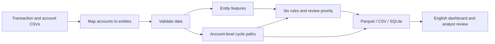

# AMLens — Entity Monitoring and Review

A repeatable pandas pipeline, SQLite storage and an English Streamlit dashboard.
Six rules generate review priorities and complete transaction evidence for account cycles.

## Open the code

Open the project folder in Visual Studio Code. Start with `src/aml_pipeline/main.py`
for the executable pipeline. `notebooks/01_data_inspection.py` contains the original
data inspection workflow.

## Run

```bash
python3 -m venv .venv
source .venv/bin/activate
python -m pip install -r requirements.txt
cp .env.example .env
PYTHONPATH=src python -m aml_pipeline.main
streamlit run dashboard/dashboard.py --server.address 127.0.0.1 --server.port 8502
```

Before running the pipeline, place `HI-Small_Trans.csv` and `HI-Small_accounts.csv`
in the project root. Source datasets, generated outputs and local credentials are
excluded from Git. For an existing setup, activate `.venv` and skip environment creation
and the template copy. No API key is needed to run the pipeline or dashboard.
Open the dashboard at http://127.0.0.1:8502/.

## Pipeline



| Stage | Source |
|---|---|
| Load | `src/aml_pipeline/load_data.py` |
| Map accounts | `src/aml_pipeline/entity_mapping.py` |
| Validate | `src/aml_pipeline/validation.py` |
| Aggregate entity features | `src/aml_pipeline/build_entity_features.py` |
| Find two- and three-edge cycles | `src/aml_pipeline/cycle_detection.py` |
| Apply rules and assign priority | `src/aml_pipeline/risk_rules.py` |
| Save outputs, preserve analyst reviews | `src/aml_pipeline/storage.py` |
| Orchestrate stages | `src/aml_pipeline/main.py` |
| Display evidence and review cases | `dashboard/dashboard.py` |
| Optional AI explanation | `src/aml_pipeline/ai_insight.py` |

## Active rules and priority

The four original rules remain: sent activity above the 97.5th percentile, outgoing
counterparty breadth above the 97.5th percentile, incoming breadth above the same
percentile, and at least 20 outgoing cross-currency transactions with at least 50%
share. The current data cutoffs are 114, 15 and 12, using strict greater-than.

Two-edge returns and three-edge closed paths are added. They must complete within
120 hours, return to the original bank/account and have strictly increasing times.
At each intermediary account, currencies match and outgoing/received amount is
80–120%. Three-edge paths require three distinct entities. All participating
entities receive the relevant rule tag.

- **High:** three-edge closed path; or a two-edge return plus any original rule.
- **Medium:** two-edge return alone; or original scale/breadth plus currency signals.
- **Low:** a single original signal family. The three scale/breadth rules share one family.

The highest matching level applies. Priority is a review policy, not a summed score
or a probability. Rule count is displayed separately. Labels are excluded from
all detection and priority conditions.

## Dashboard

Four tabs: Overview, Alert Queue, Investigation, Performance & Rules. Investigation
shows each entity's triggered rules and priority reason. Select a cycle case to see
the directed path and every underlying transaction in chronological order. Recent
activity is shown separately; it is not a substitute for rule-triggering evidence.
Analyst status, notes and review history persist across pipeline reruns.

## API entry

Copy `.env.example` to `.env` during initial setup. For optional AI explanations,
set `OPENROUTER_API_KEY` in `.env` and optionally change `OPENROUTER_MODEL`, then
restart Streamlit. The template contains no API key; `.env` is excluded from Git.
Optional AI receives aggregate counts only and responds in English. It does not
assign priorities or save case decisions.

## Evaluation limits

Full-period retrospective results are not held-out validation. The cycle window
was informed by development-set diagnostics. Negative-label alerts count as false
positives in this synthetic benchmark. Candidate paths may reuse incoming receipts;
there is no balance calculation, unique funds allocation or FX-normalized final
return-value test. Only two- and three-edge cycles are searched. Monotonic precision
across priority tiers is not guaranteed. Local exploratory scripts under `analysis/`
are historical experiments, excluded from Git and not used by the production pipeline.
